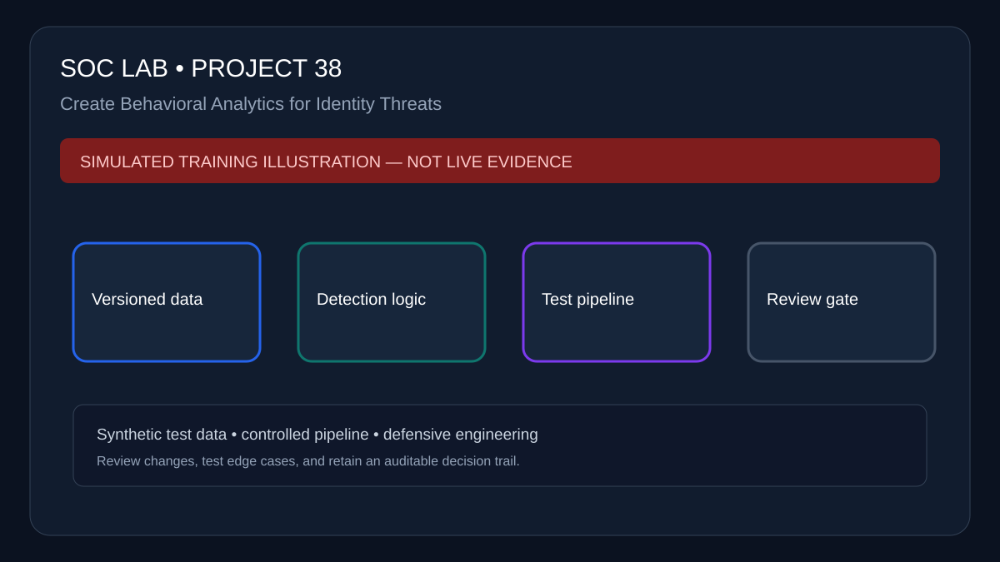
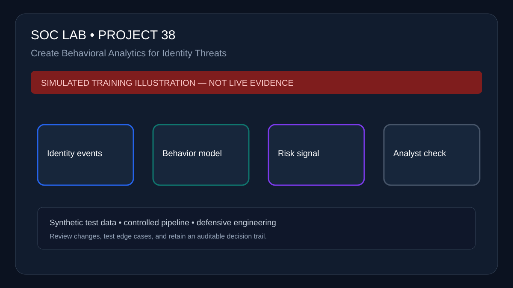
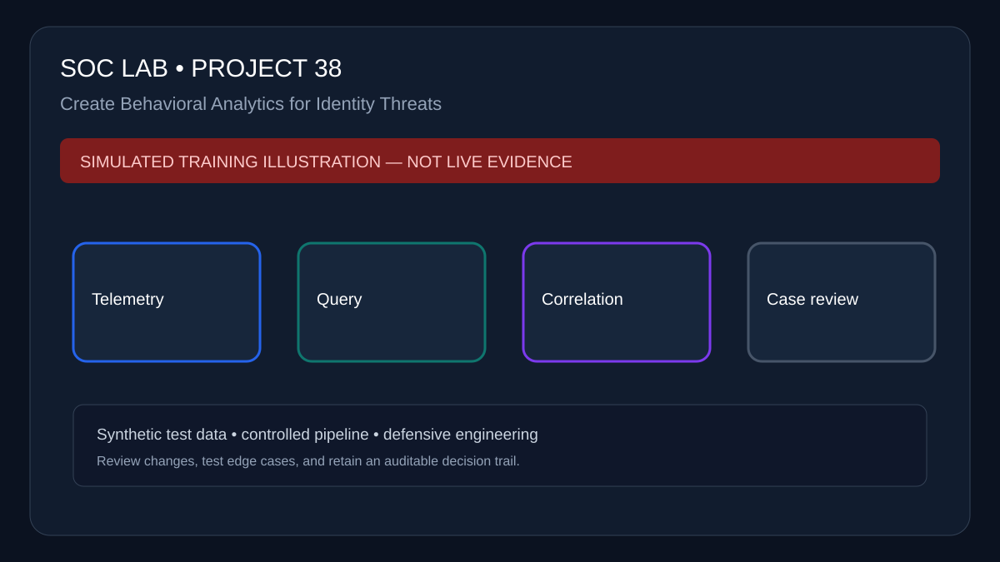

# Project 38: Create Behavioral Analytics for Identity Threats

**Level:** Advanced · **Track:** SOC Operations / SIEM



## Objective
Create Behavioral Analytics for Identity Threats. Build a production-minded defensive capability with versioned logic, explicit data dependencies, controlled validation, and analyst-ready outcomes.

## Scope and safety
Use authorized lab telemetry and synthetic datasets. Never execute malicious code, abuse identity protocols, or access systems outside scope. All simulated attack behavior is represented by benign records or approved emulation in an isolated environment.

## Prerequisites
SIEM (Elastic/Splunk or equivalent), Sysmon/Windows security events, identity and network telemetry, Git, query language, and Python or CI tooling as applicable.

## Architecture and preparation
1. Define owners, scope, authorization, data retention, and success measures.
2. Map data sources, parsing, enrichment, storage, detection content, and analyst workflow.
3. Preserve a baseline dataset and create synthetic positive/negative test fixtures.
4. Store rules/configuration in version control; protect secrets and restrict pipeline permissions.

## Engineering workflow
1. Formulate the detection hypothesis and identify observable behaviors.
2. Specify required event fields, entity keys, lookback window, and expected gaps.
3. Implement versioned query/rule/configuration with comments and change rationale.
4. Add automated linting, schema checks, unit tests, and positive/negative fixtures where supported.
5. Validate with controlled synthetic data; check duplicate, missing, delayed, and out-of-order events.
6. Review alert context, false positives, performance, and operational impact with an analyst.
7. Promote through review gates; document rollback, monitoring, and retest ownership.



## Example analytic validation search
Adapt to your SIEM:

```text
index=lab | stats count values(event_id) as evidence by user, host, rule_name | sort - count
```

Keep tests deterministic and datasets sanitized. Document the precise version of the rule and test fixtures used for each result.

## Expected results
Versioned detection/configuration, architecture diagram, test fixtures, automated validation output, analyst triage notes, performance observations, and rollback instructions.

## Risk and triage
Assess identity privilege, asset criticality, confidence, corroboration, and impact. Explain how analysts distinguish benign administration from suspicious behavior. Human review remains required for disruptive response.

## Framework mapping
Map only substantiated behaviors to ATT&CK. Record telemetry dependencies and coverage gaps; use NIST CSF/CIS Controls as design references rather than compliance claims.

## Hardening and operations
Use least-privilege pipeline identities, protected branches, peer review, secrets management, signed artifacts where available, audit logging, staged rollout, monitoring, and a tested rollback path.

## Validation checklist
- [ ] Scope, data sources, and owners approved.
- [ ] Rule/configuration versioned and peer-reviewed.
- [ ] Positive, negative, and edge-case tests automated.
- [ ] Performance and false positives assessed.
- [ ] Promotion and rollback procedures verified.
- [ ] Analyst context and escalation guidance documented.
- [ ] Retest and maintenance cadence assigned.



## Deliverables
Architecture, detection content, CI/test output, sanitized fixtures, analyst runbook, ATT&CK mapping, risk/limitations register, and final report. Illustrations are simulated training assets, not live security evidence.
