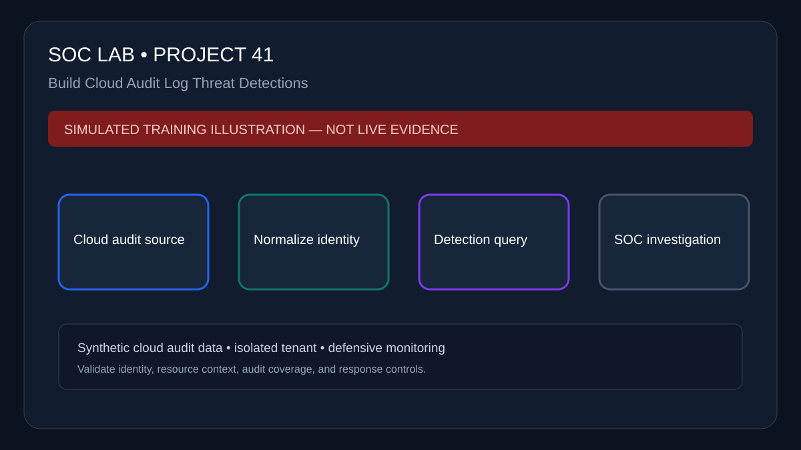
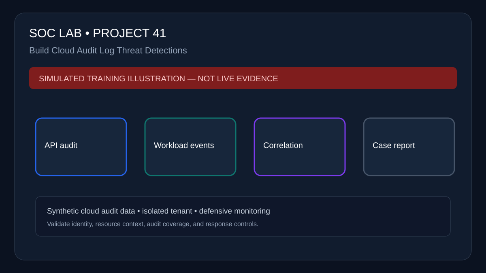

# Project 41: Build Cloud Audit Log Threat Detections

**Level:** Advanced · **Track:** SOC Operations / SIEM



## Objective
Build Cloud Audit Log Threat Detections. Engineer cloud/workload detections from authorized audit telemetry and provide a defensible analyst investigation path.

## Scope and safety
Use a dedicated lab tenant or synthetic exported logs. Do not probe third-party tenants, alter production IAM, or expose account IDs, tokens, or customer data. Keep response actions approval-gated.

## Prerequisites
Cloud audit records (Azure sign-in/activity, AWS CloudTrail, or Kubernetes audit events), Elastic/Splunk, basic cloud identity concepts, and version control.

## Lab setup
1. Create a dedicated test environment and document scope, roles, data region, retention, and authorization.
2. Enable only required audit sources using least-privilege collection permissions.
3. Export sanitized sample events and preserve originals read-only.
4. Validate actor, action, resource, source, timestamp, result, and correlation identifiers.

## Detection workflow
1. Define the cloud behavior to monitor and the audit events needed to observe it.
2. Normalize actor identity, resource, API/action, source context, and outcome.
3. Establish normal activity and known automation/service principals.
4. Build a detection query with bounded windows, entity context, and risk-based conditions.
5. Validate with synthetic suspicious and benign records; include role changes, automation, and failed requests as controls.
6. Correlate identity, control-plane, network, and workload logs to establish scope.
7. Document severity, confidence, response options, and audit evidence.


## Example query pattern
Adapt fields and syntax to your SIEM:

```text
index=cloud_lab | stats count values(action) as actions by actor, source_ip, resource | sort - count
```

Treat unusual cloud activity as a lead. Confirm the principal, resource ownership, change ticket, automation schedule, and outcome before escalation.

## Expected results
Versioned detection, sanitized event fixtures, source-to-field mapping, test matrix, analyst timeline, and documented cloud-specific telemetry limitations.

## Triage and severity
Assess principal privilege, resource sensitivity, action impact, source context, successful changes, and corroborating events. Escalate suspicious privileged changes or access to sensitive resources. Avoid automatic rollback without owner approval.

## Framework mapping
Map observed cloud behavior to ATT&CK where supported. Record relevant cloud control objectives and logging coverage; do not claim compliance or certification from this lab.

## Remediation
Use least-privilege roles, MFA/conditional access, workload identity protections, audit retention, policy guardrails, network restrictions, and change approval. Protect log collectors and service credentials.

## Validation checklist
- [ ] Dedicated scope and least-privilege collection configured.
- [ ] Audit event fields and provenance verified.
- [ ] Normal automation baseline documented.
- [ ] Positive/benign test fixtures validated.
- [ ] Query, alert context, and escalation documented.
- [ ] Response approval and rollback considered.
- [ ] Evidence sanitized and securely retained.



## Deliverables
Cloud audit configuration, detection query, sanitized events, field map, test matrix, triage timeline, remediation plan, and final report. SVGs are simulated training visuals, not live cloud screenshots or incident evidence.
