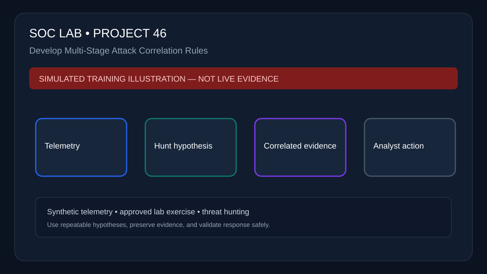
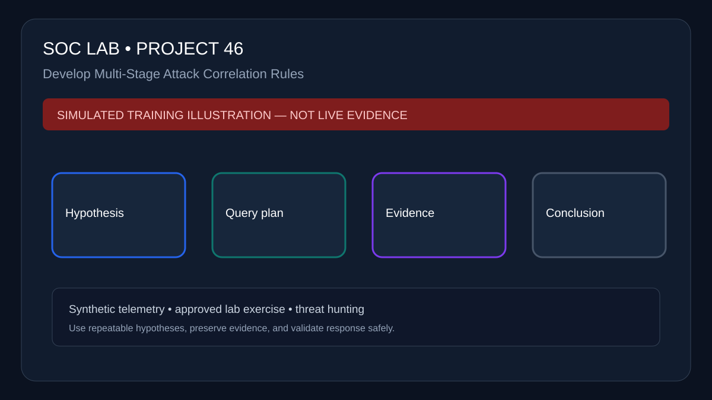

# Project 46: Develop Multi-Stage Attack Correlation Rules

**Level:** Advanced · **Track:** SOC Operations / SIEM



## Objective
Develop Multi-Stage Attack Correlation Rules. Develop an evidence-led hunt or response workflow with explicit hypotheses, safe validation, and measurable outcomes.

## Scope and safety
Operate only on approved networks, endpoints, and datasets. Use synthetic telemetry or sanctioned emulation in isolated labs. Do not access third-party traffic or execute destructive actions. Automation must require human approval for containment.

## Prerequisites
SIEM platform, DNS/proxy/firewall/endpoint/identity sample logs, query skills, case management, and version control. For automation, use a dedicated least-privilege service identity.

## Preparation
1. Document authorization, scope, assets, data sources, time range, and evidence retention.
2. Define the threat hypothesis, expected telemetry, and benign alternative explanations.
3. Preserve a baseline dataset and create synthetic test fixtures.
4. Confirm parsing, time synchronization, source provenance, and access controls.

## Guided workflow
1. Write a falsifiable hypothesis and identify the behavior and entities to investigate.
2. Build a query plan with bounded time windows, stable keys, and explicit exclusions.
3. Search baseline and scenario telemetry; preserve query text and event references.
4. Correlate related events to reconstruct a sequence and identify affected assets.
5. Validate the hypothesis against benign controls and competing explanations.
6. Assess confidence, impact, scope, and escalation thresholds.
7. Document response actions, approvals, evidence handling, and lessons learned.


## Example query pattern
Adapt to your SIEM:

```text
index=lab sourcetype=network:* | stats count values(dest) as destinations by src, user, _time | sort _time
```

Use a bounded time range and validate field quality. Do not treat periodicity, rarity, or reputation alone as proof of malicious activity.

## Expected results
A repeatable hunt/playbook, saved queries, synthetic test results, timeline, entity scope, benign comparisons, and documented limitations.

## Triage and severity
Prioritize evidence of successful access, privileged activity, sensitive assets, persistence, or data exposure. Separate confirmed observations from hypotheses and escalate according to the approved incident process.

## Framework mapping
Map substantiated behaviors to ATT&CK and document telemetry coverage. Reference NIST CSF/CIS Controls for response readiness and governance without claiming compliance.

## Remediation and improvement
Improve visibility, least privilege, endpoint/network controls, segmentation, alert quality, and playbooks. For automation, implement approvals, idempotency, rate limits, logging, secrets protection, and rollback.

## Validation checklist
- [ ] Authorization, scope, and hypothesis documented.
- [ ] Query plan and telemetry sources defined.
- [ ] Baseline and benign alternatives considered.
- [ ] Positive and negative tests completed.
- [ ] Evidence and timeline reproducible.
- [ ] Approval gates and rollback tested where applicable.
- [ ] Findings and lessons learned recorded.



## Deliverables
Hypothesis, query pack, synthetic fixtures, hunt timeline, evidence register, response playbook, test results, remediation backlog, and final report. SVGs are simulated training illustrations, not real incident screenshots.
