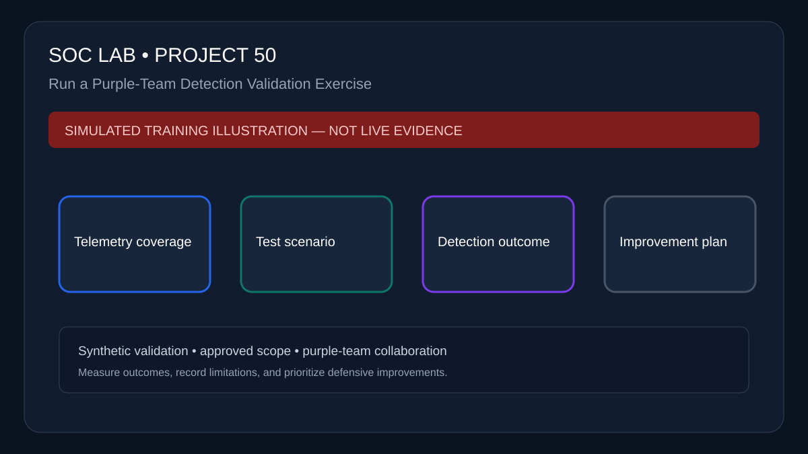
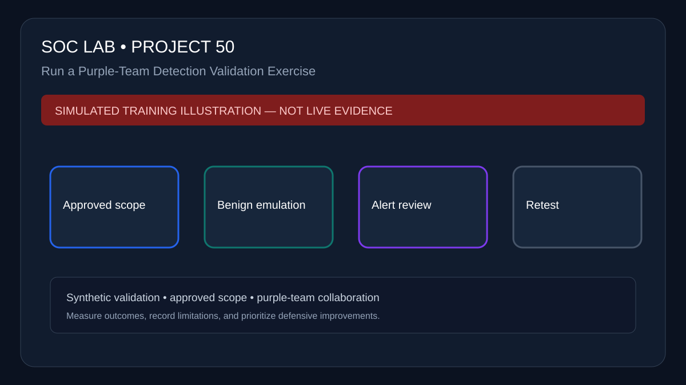
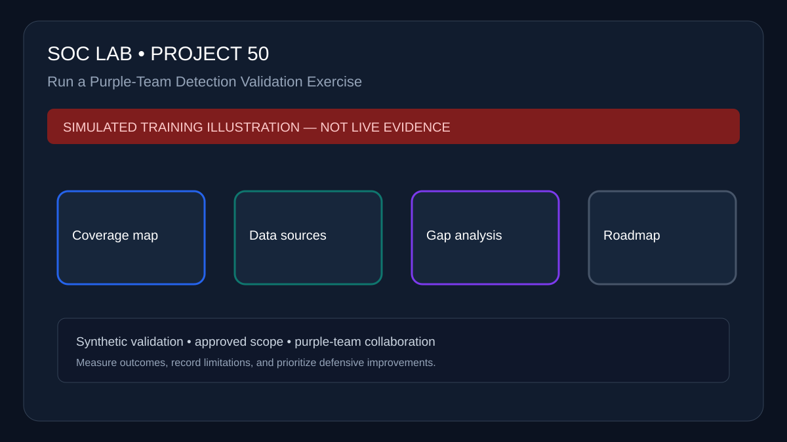

# Project 50: Run a Purple-Team Detection Validation Exercise

**Level:** Advanced · **Track:** SOC Operations / SIEM



## Objective
Run a Purple-Team Detection Validation Exercise. Evaluate detection capability through a measurable, authorized, and repeatable engineering process.

## Scope and safety
Obtain written approval, define assets and time windows, and use isolated systems or approved benign emulation. Do not conduct unapproved exploitation, persistence, credential theft, or disruptive testing. Stop conditions and emergency contacts must be documented.

## Prerequisites
SIEM and endpoint/network telemetry, version-controlled detection rules, synthetic test fixtures or a sanctioned validation framework, ATT&CK mapping, and a case/report template.

## Preparation
1. Define scope, owners, authorization, objectives, and rules of engagement.
2. Inventory data sources, detection content, ATT&CK mappings, and known blind spots.
3. Establish baseline metrics and define success criteria before testing.
4. Create a test plan with benign scenarios, expected telemetry, expected alert, and stop conditions.

## Guided workflow
1. Select a defensive hypothesis or coverage objective.
2. Map the behavior to relevant ATT&CK techniques only where applicable.
3. Confirm required telemetry is enabled and data quality is adequate.
4. Run only benign, approved simulations or replay synthetic event fixtures.
5. Record whether the expected events arrived, analytic matched, alert context was useful, and analyst response was timely.
6. Classify failures: missing telemetry, parsing issue, rule gap, tuning issue, workflow gap, or analyst context gap.
7. Prioritize remediation by risk and retest with the same repeatable fixture.



## Example coverage query
Adapt to your SIEM and schema:

```text
index=lab | stats count values(rule_name) as detections by technique, data_source | sort technique
```

Do not equate a mapped technique with effective coverage. Require observed telemetry and a successful validation result.

## Expected results
Coverage matrix, test plan, sanitized evidence, detection outcome, gap classification, remediation backlog, and retest record.

## Measurement model
Track data-source availability, analytic execution, true-positive test detection, false-positive rate, alert context quality, mean time to acknowledge, and mean time to respond. Define denominators and test conditions; do not inflate coverage by counting untested mappings.

## Framework mapping
Use ATT&CK for behavior coverage and NIST CSF/CIS Controls for broader defensive maturity. Clearly distinguish mapping, implementation, and validated effectiveness.

## Remediation
Prioritize missing logs, parsing defects, detection logic, enrichment, alert routing, playbook clarity, and analyst training. Assign an owner, target date, and objective retest condition.

## Validation checklist
- [ ] Written scope and approval recorded.
- [ ] Test plan, expected outcomes, and stop conditions approved.
- [ ] Telemetry and analytic versions recorded.
- [ ] Positive and benign controls executed safely.
- [ ] Results measured against predefined criteria.
- [ ] Gaps assigned owners and retest dates.
- [ ] Final report separates facts, assumptions, and limitations.



## Deliverables
Coverage matrix, approved test plan, sanitized event evidence, query/rule versions, result metrics, gap register, remediation plan, and executive summary. SVGs are simulated training illustrations, not live test screenshots or evidence.
