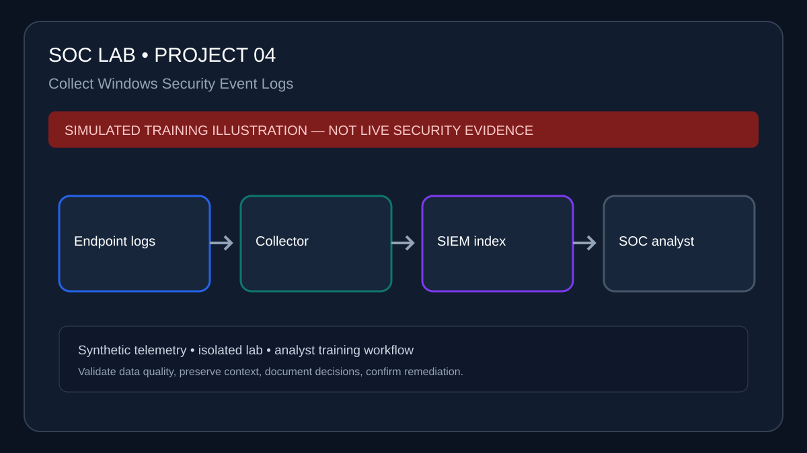
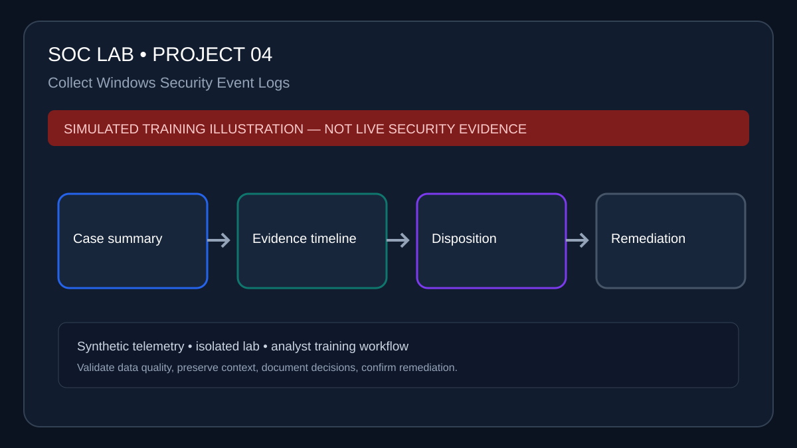

# Project 04: Collect Windows Security Event Logs

**Level:** Beginner · **Track:** SOC Operations / SIEM



## Objective
Build a repeatable defensive SOC workflow: collect windows security event logs. Deliver a working lab, documented data flow, analyst notes, and a concise report.

## Authorization and safety
Use only systems you own or are explicitly authorized to monitor. Keep virtual machines on an isolated lab network. Use synthetic or sanitized events; never upload client logs, credentials, personal data, or regulated records to public services. This is defensive training, not a live assessment.

## Prerequisites
- Kali or analyst workstation plus a Windows/Linux lab endpoint as applicable.
- VirtualBox/VMware, sufficient RAM and disk, synchronized clocks.
- Elastic Security or Splunk Free, Windows Event Viewer, Sysmon, Linux journalctl, and sample EVTX/JSON/CSV telemetry.
- A case notebook and a dedicated lab account.

## Lab setup
1. Create an isolated virtual network and document its range, hosts, time zone, and purpose.
2. Install the SIEM/collector and one monitored endpoint. Keep management interfaces off untrusted networks.
3. Import a known-good baseline dataset; preserve originals read-only.
4. Verify ingestion, timestamps, hostname, user, event/action, and source fields before analysis.

## Guided exercise
1. Define the security question and expected event sources.
2. Establish normal activity using baseline events; note expected administrators, services, and scheduled tasks.
3. Configure collection for the relevant event channels and validate that events arrive without material loss or clock skew.
4. Normalize fields and build a search or dashboard around the behavior, not a single brittle indicator.
5. Compare a synthetic positive case with a benign control case. Do not execute malware or disruptive actions.
6. Triage by correlating account, host, source, destination, process, and time. Preserve the query and event identifiers.
7. Record confidence, severity rationale, scope, evidence, containment recommendation, and escalation decision.


## Example SIEM query
Adapt index names and field mappings to your platform:

```text
index=lab sourcetype=WinEventLog:* | stats count by EventCode, host
```

Record the exact time range, query, data source, fields, and result count. A query match is an investigative lead, not proof of compromise.

## Expected results
- Verified event flow from endpoint to SIEM with source and timestamp context.
- Search/dashboard output that can be reproduced by another analyst.
- Documented positive and benign examples, false-positive causes, and data limitations.
- A short case timeline with evidence references.

## Triage and severity
Assess asset criticality, account privilege, confidence, exposure, and evidence of impact. Separate facts from hypotheses. Escalate events involving privileged identities, sensitive assets, persistence, data access, or multiple hosts. Do not label an event malicious solely because a rule fired.

## Framework mapping
Map only observed behavior to relevant MITRE ATT&CK tactics/techniques. Record required telemetry and coverage gaps. CIS Controls or NIST CSF can be used as defensive reference points; completing this lab does not establish compliance or certification.

## Remediation
Recommend least privilege, hardened configurations, sufficient log retention, identity protection, endpoint controls, network segmentation, and playbook improvements as relevant. Assign an owner and due date to each action.

## Validation checklist
- [ ] Scope and authorization recorded.
- [ ] Data sources, collection settings, and field mappings documented.
- [ ] Positive and benign test cases reviewed.
- [ ] Queries/configuration versioned and reproducible.
- [ ] False positives and blind spots documented.
- [ ] Evidence sanitized and access-controlled.
- [ ] Another analyst can reproduce the workflow.



## Deliverables
Submit the lab diagram, collection configuration, query/dashboard, sanitized sample events, analyst timeline, tuning notes, remediation recommendations, and a concise report. All three SVG assets are simulated training illustrations, not screenshots from a live system or proof of real-world detection.

## Report outline
**Summary · Scope · Data sources · Method · Findings · Timeline · Severity/confidence · Limitations · Recommendations · Validation · Appendix.**
