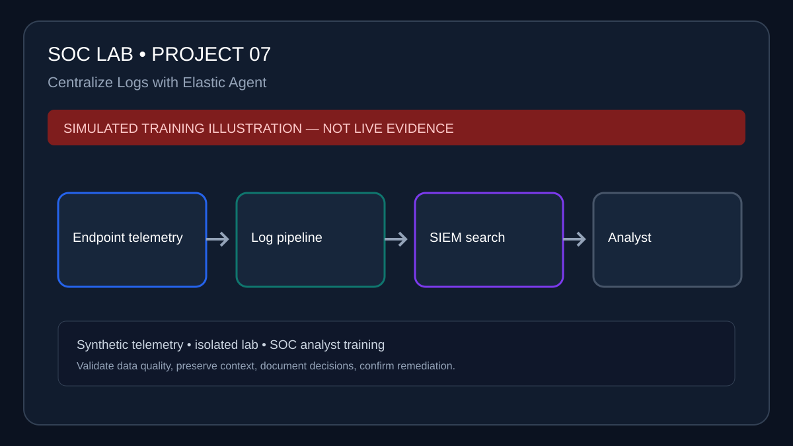
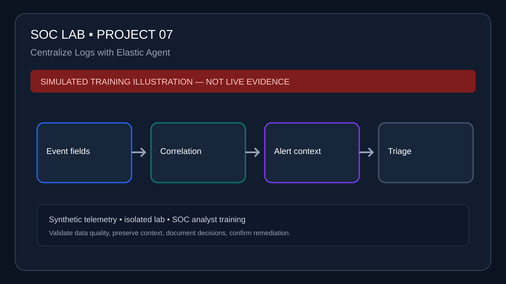
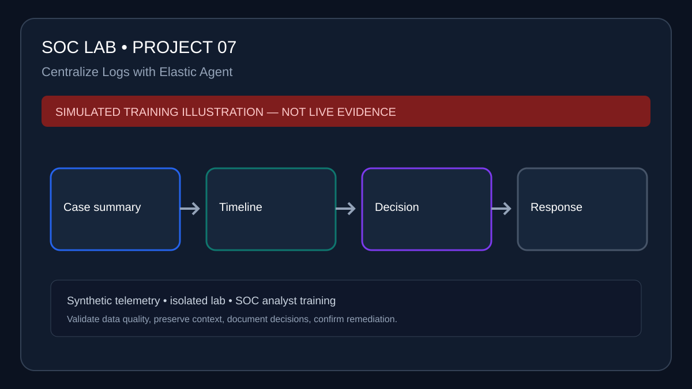

# Project 07: Centralize Logs with Elastic Agent

**Level:** Beginner · **Track:** SOC Operations / SIEM



## Objective
Centralize Logs with Elastic Agent. Build a reproducible defensive workflow and document the telemetry, analyst decisions, and improvements.

## Scope and safety
Use only owned or explicitly authorized systems. Work in an isolated lab with synthetic or sanitized events. Do not upload client logs, credentials, personal data, or regulated records to public services. This is defensive training; do not disrupt production systems or execute malicious payloads.

## Prerequisites
- Windows or Linux lab endpoint and an analyst workstation.
- VirtualBox/VMware, synchronized clocks, and a dedicated lab account.
- Elastic Security or Splunk Free; Sysmon/Event Viewer or journalctl as appropriate; sample EVTX/JSON/CSV telemetry.
- A case notebook and storage for sanitized evidence.

## Lab preparation
1. Document the lab network, hostnames, time zone, software versions, and authorization.
2. Deploy the collector/SIEM and configure the selected event source.
3. Import a known-good baseline dataset and preserve originals read-only.
4. Confirm event arrival, timestamps, host identity, user, event/action, and source fields. Note ingestion delay and missing fields.

## Guided workflow
1. Define the question, monitored entities, expected telemetry, and success criteria.
2. Establish normal behavior from baseline events; record known administrative and scheduled activity.
3. Configure collection and normalization; validate representative records end-to-end.
4. Build a search, dashboard, or workflow focused on observable behavior rather than one brittle indicator.
5. Compare a synthetic positive scenario with a benign control case. Do not run malware or disruptive tests.
6. Triage using account, host, source, destination, process, and time context. Preserve query text and event IDs.
7. Record confidence, severity rationale, affected scope, evidence, recommended response, and escalation decision.



## Example SIEM search
Adapt index and field names to your environment:

```text
index=lab sourcetype=WinEventLog:* | stats count by EventCode, host
```

Record the query, exact time range, data source, field mapping, and result count. A match is an investigative lead, not proof of compromise.

## Expected observations
- Verified event delivery with consistent source and timestamp context.
- Reproducible search/dashboard results and a documented event trail.
- Positive and benign examples, false-positive causes, and data limitations.
- A short timeline that another analyst can reproduce.

## Triage and severity
Consider asset criticality, identity privilege, confidence, exposure, and evidence of impact. Separate facts from hypotheses. Escalate when privileged identities, sensitive assets, persistence, data access, or multiple hosts are involved. Never classify solely from a rule firing.

## Framework mapping
Map only behavior represented by the lab to relevant MITRE ATT&CK tactics/techniques. Record telemetry dependencies and coverage gaps. CIS Controls/NIST CSF may guide defensive improvements; this exercise does not establish compliance or certification.

## Remediation
Recommend least privilege, secure configuration, logging coverage and retention, identity protection, endpoint controls, segmentation, and playbook improvements as appropriate. Assign owners and due dates.

## Validation checklist
- [ ] Authorization and scope recorded.
- [ ] Sources, collection settings, and field mappings documented.
- [ ] Positive and benign cases reviewed.
- [ ] Queries/configuration versioned and reproducible.
- [ ] False positives and blind spots recorded.
- [ ] Evidence sanitized and access-controlled.
- [ ] Another analyst can repeat the workflow.



## Deliverables
Lab diagram, collection configuration, search/dashboard, sanitized event samples, timeline, tuning notes, remediation plan, and concise report. The three SVG assets are simulated training illustrations—not live screenshots or proof of real-world detection.

## Report outline
**Summary · Scope · Data sources · Method · Findings · Timeline · Severity/confidence · Limitations · Recommendations · Validation · Appendix.**
