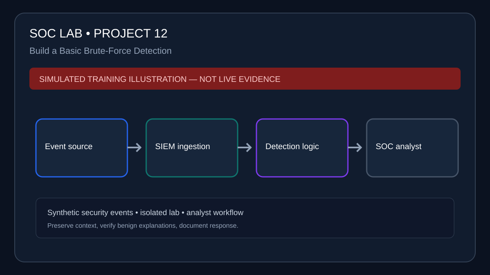
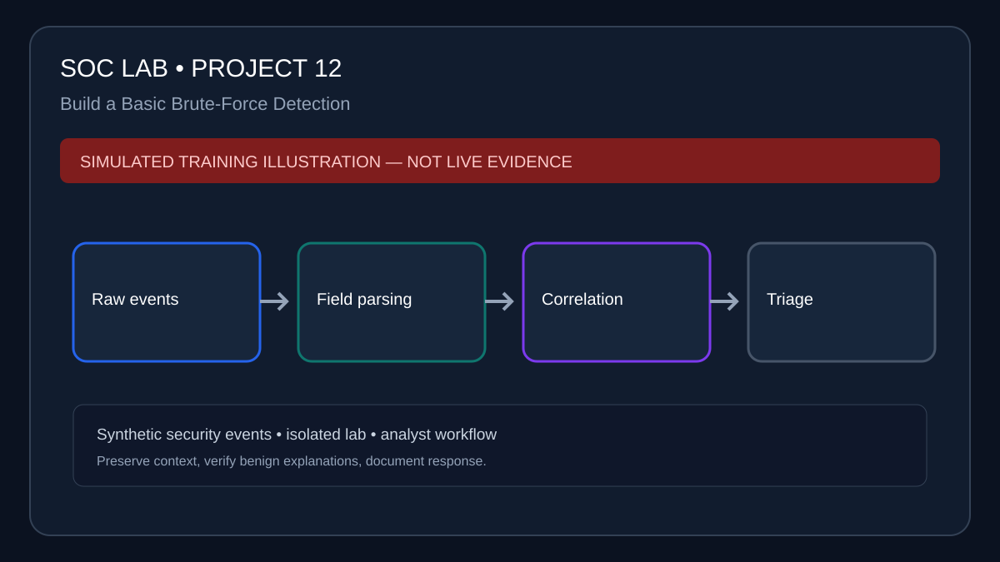
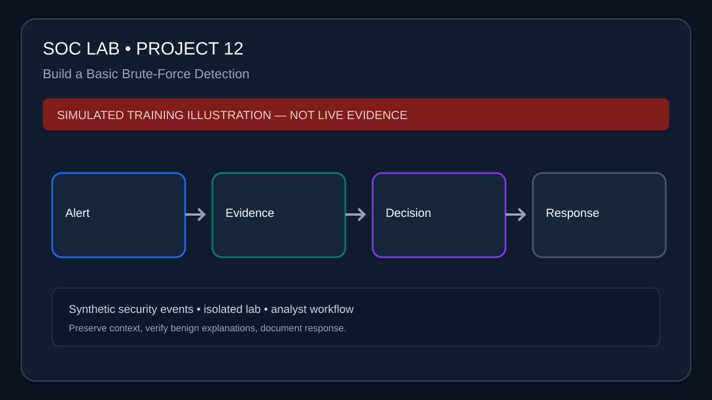

# Project 12: Build a Basic Brute-Force Detection

**Level:** Beginner · **Track:** SOC Operations / SIEM



## Objective
Build a Basic Brute-Force Detection. Produce a reproducible investigation using authorized lab telemetry, with documented evidence, analyst decisions, and defensive recommendations.

## Scope and safety
Use only systems you own or are authorized to monitor. Work in an isolated lab with synthetic or sanitized logs. Do not upload client records, secrets, credentials, or personal data to public services. Avoid disruptive testing and do not execute malware.

## Prerequisites
- Windows/Linux lab endpoint and analyst workstation; VirtualBox/VMware recommended.
- Elastic Security or Splunk Free; Windows Event Viewer/Sysmon or Linux journalctl.
- Synchronized clocks, sample EVTX/JSON/CSV events, case notebook, and evidence storage.

## Lab setup
1. Record authorization, network scope, hostnames, software versions, and time zone.
2. Configure log collection and verify the endpoint identity and event source.
3. Import a baseline dataset and retain original files read-only.
4. Check timestamp quality, ingestion delay, field mappings, and duplicate/missing records.

## Investigation steps
1. State the detection hypothesis and expected evidence.
2. Establish baseline behavior for the same account, host, and time period.
3. Search for the relevant event pattern; group by account, source, host, and time window.
4. Pivot to related authentication, endpoint, and network records to build context.
5. Compare synthetic suspicious events with benign administrative or user-error cases.
6. Determine affected identities/assets, confidence, likely impact, and whether escalation is warranted.
7. Record a timeline, query, event identifiers, analyst rationale, and next actions.



## Example SIEM query
Adapt field names and index to your dataset:

```text
index=lab sourcetype=WinEventLog:* | stats count by EventCode, user, src_ip, host
```

Use a bounded time range. Explain the threshold and aggregation key; a search match is a lead, not proof of compromise.

## Expected results
A reproducible event sequence, clear identity/host context, benign comparison, false-positive notes, and a concise triage conclusion. Note gaps such as missing source IPs, clock skew, or incomplete endpoint logging.

## Triage and severity
Consider privileged access, asset criticality, frequency, geographic/network context, and corroborating events. Distinguish failed attempts from successful access. Escalate when evidence suggests account compromise, privileged activity, or multiple affected systems.

## Framework mapping
Map only the behavior evidenced in the scenario to MITRE ATT&CK. Record required log sources and detection coverage gaps. CIS Controls and NIST CSF can inform improvements; this lab is not a compliance certification.

## Remediation
Apply appropriate controls such as MFA, lockout/risk-based authentication, strong password policy, least privilege, endpoint logging, network restrictions, and user education. Avoid automatic account lockouts or blocking without operational review.

## Validation checklist
- [ ] Scope and authorization documented.
- [ ] Baseline and test data identified.
- [ ] Query and time window saved.
- [ ] Positive and benign cases compared.
- [ ] False positives and telemetry gaps documented.
- [ ] Evidence sanitized and stored securely.
- [ ] Another analyst can reproduce the conclusion.



## Deliverables
Sanitized events, search query, investigation timeline, affected-entity summary, severity/confidence rationale, remediation plan, and final report. All SVGs are simulated training illustrations, not live screenshots or assessment evidence.

## Report outline
**Summary · Scope · Data sources · Method · Findings · Timeline · Impact · Limitations · Recommendations · Validation · Appendix.**
