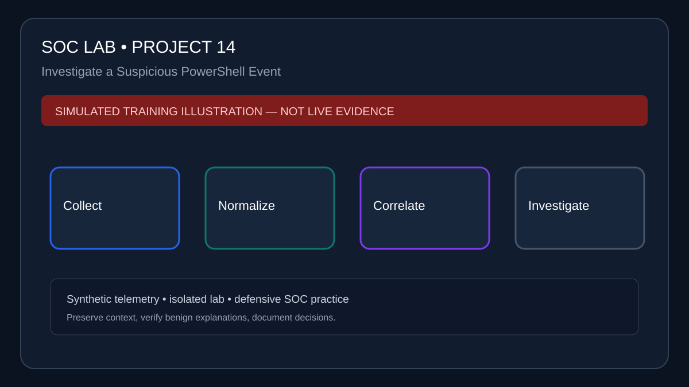
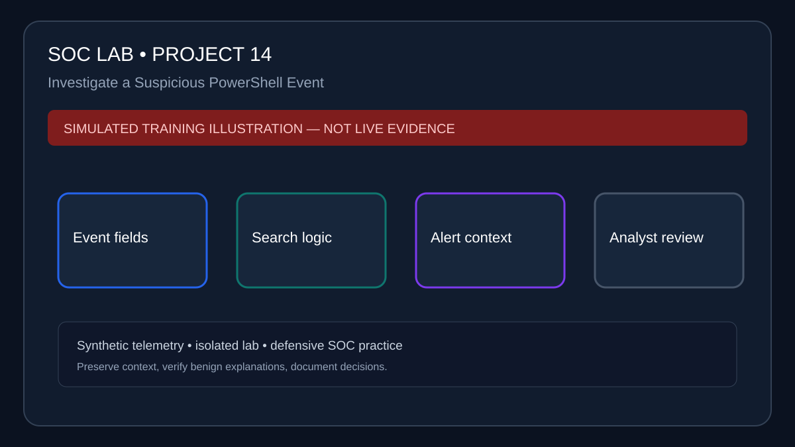

# Project 14: Investigate a Suspicious PowerShell Event

**Level:** Beginner · **Track:** SOC Operations / SIEM



## Objective
Investigate a Suspicious PowerShell Event. Develop a repeatable defensive workflow that turns authorized telemetry into a documented analyst decision and measurable security improvement.

## Authorization and safety
Use owned or explicitly authorized systems only. Prefer an isolated lab and synthetic/sanitized logs. Never publish credentials, client logs, personal data, or regulated records. Do not execute malware, send real phishing messages, or disrupt production services.

## Prerequisites
- Analyst workstation and isolated Windows/Linux lab endpoints.
- Elastic Security or Splunk; Sysmon/Event Viewer, Linux journal, email-header samples, or sanitized telemetry as applicable.
- Synchronized clocks, versioned notes, and secure evidence storage.

## Lab preparation
1. Define scope, authorization, data sources, hosts, time zone, and retention.
2. Deploy/configure the relevant collector and verify ingestion and field mappings.
3. Preserve original sample data read-only and document its provenance.
4. Establish a benign baseline and note expected administrative/user activity.

## Guided workflow
1. Define the hypothesis, entities of interest, expected indicators, and success criteria.
2. Normalize event fields and validate timestamps, host/account identifiers, and missing values.
3. Build a search, dashboard, detection rule, or analyst playbook using multiple contextual fields.
4. Test with synthetic positive and benign-control records; record the exact query and time range.
5. Pivot across identity, endpoint, network, or message telemetry to scope related activity.
6. Assess confidence, severity, impact, and escalation requirements. Separate verified facts from assumptions.
7. Document evidence, timeline, containment options, remediation, and validation plan.



## Example SIEM query
Adapt field names and index to your platform:

```text
index=lab | stats count by host, user, event_type | sort - count
```

Bound the time window and explain each filter. Treat matches as leads requiring corroboration, not automatic proof of compromise.

## Expected results
A reproducible workflow, clear data lineage, relevant event sequence, benign comparison, false-positive notes, and a written conclusion. Document any telemetry gaps or collection delays.

## Triage and severity
Consider account privilege, asset criticality, confidence, exposure, corroborating events, and evidence of impact. Escalate suspicious activity involving privileged identities, sensitive systems, persistence, or multiple assets. Use human review before containment actions that could affect business operations.

## Framework mapping
Map only demonstrated behavior to MITRE ATT&CK. Document data-source dependencies and coverage gaps. Use CIS Controls/NIST CSF as references for defensive improvements, not as a claim of certification.

## Remediation and validation
Recommend least privilege, MFA, secure configuration, endpoint/email controls, logging and retention, network segmentation, and analyst training as relevant. Re-run the benign and synthetic test cases after changes; verify the analytic still detects the intended behavior without excessive false positives.

## Completion checklist
- [ ] Scope and authorization recorded.
- [ ] Data provenance and field mappings documented.
- [ ] Query/rule/playbook saved with bounded time range.
- [ ] Positive and benign tests evaluated.
- [ ] Evidence sanitized and access-controlled.
- [ ] False positives, blind spots, and tuning decisions recorded.
- [ ] Remediation owner and retest criteria identified.


## Deliverables
Configuration or rule, sanitized event samples, query, investigation timeline, severity rationale, response recommendations, validation results, and final report. SVGs are simulated training illustrations—not live screenshots or evidence from a real incident.

## Report outline
**Executive summary · Scope · Data sources · Method · Findings · Timeline · Impact · Limitations · Recommendations · Validation · Appendix.**
