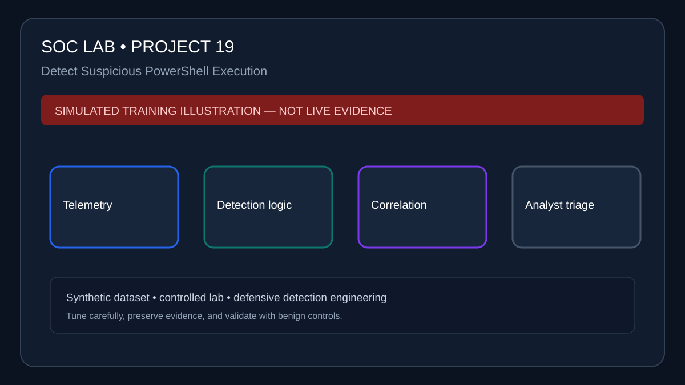

# Project 19: Detect Suspicious PowerShell Execution

**Level:** Intermediate · **Track:** SOC Operations / SIEM



## Objective
Detect Suspicious PowerShell Execution. Engineer and validate an explainable detection or investigation workflow from authorized endpoint, identity, or network telemetry.

## Scope and safety
Use owned systems, isolated labs, and synthetic/sanitized logs. No real credential attacks, phishing delivery, malware execution, or disruption. Keep client data and secrets out of public repositories.

## Prerequisites
Elastic Security or Splunk, Sigma tooling where relevant, Windows Event Logs/Sysmon, Linux or network sample telemetry, and basic query skills. Maintain synchronized clocks and version-controlled rules.

## Lab setup
1. Document scope, hosts, accounts, data sources, time zone, and authorization.
2. Import baseline and synthetic scenario records; preserve source files read-only.
3. Validate field mappings, event completeness, and ingestion latency.
4. Identify the ATT&CK behavior and the benign workflows likely to resemble it.

## Engineering workflow
1. Write a detection hypothesis and specify the telemetry required to test it.
2. Establish baseline behavior and define entities, aggregation keys, lookback window, and threshold.
3. Develop a query or Sigma rule with clear field mappings and comments.
4. Validate against positive synthetic records and benign controls; document expected match/no-match behavior.
5. Correlate related identity, endpoint, and network events to enrich context.
6. Tune exclusions narrowly and explain each exception; avoid broad suppressions.
7. Record alert severity, confidence, investigation pivots, and response playbook steps.


## Example query pattern
Adapt the fields and syntax to your platform:

```text
index=lab | bin _time span=10m | stats dc(user) as users count by src_ip, _time | where count > 5
```

This is an illustrative pattern only. Choose thresholds from your dataset, avoid exposing real identities, and do not use it to target systems outside your authorization.

## Expected results
Versioned analytic, test cases, query output, documented false-positive conditions, and a clear mapping between the observed behavior and the telemetry supporting the alert.

## Triage and severity
Corroborate the signal with asset criticality, identity privilege, source context, successful follow-on activity, and related endpoint events. Distinguish suspicious patterns from shared NAT, scanners, service accounts, and administrative maintenance.

## ATT&CK and control mapping
Map the demonstrated behavior to ATT&CK only when supported by evidence. Record data-source dependencies and coverage limitations. Use NIST CSF/CIS Controls as improvement references, not compliance claims.

## Remediation and tuning
Improve MFA and identity controls, endpoint telemetry, least privilege, secure configuration, and monitoring coverage as appropriate. Re-test after every rule change. Track precision, alert volume, false-positive rate, and missed test cases.

## Validation checklist
- [ ] Detection hypothesis and scope documented.
- [ ] Required telemetry and field mappings verified.
- [ ] Positive and benign test cases included.
- [ ] Rule/query versioned and reviewed.
- [ ] Tuning decisions and exclusions justified.
- [ ] Analyst playbook and escalation criteria documented.
- [ ] Retest evidence and limitations recorded.


## Deliverables
Detection rule/query, synthetic test data, test results, ATT&CK mapping, false-positive analysis, analyst playbook, and concise engineering report. Illustrations are simulated training visuals, not live evidence.
