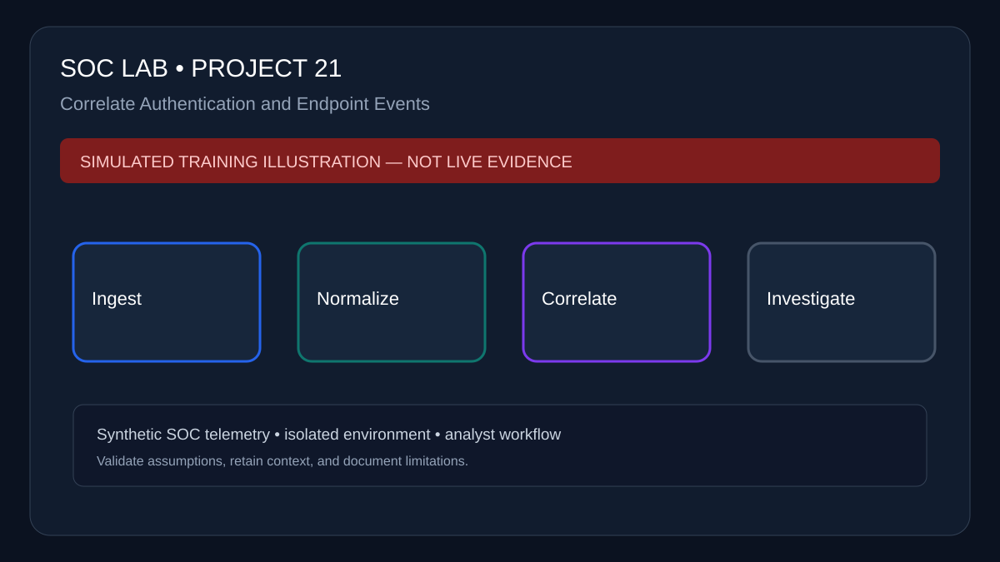
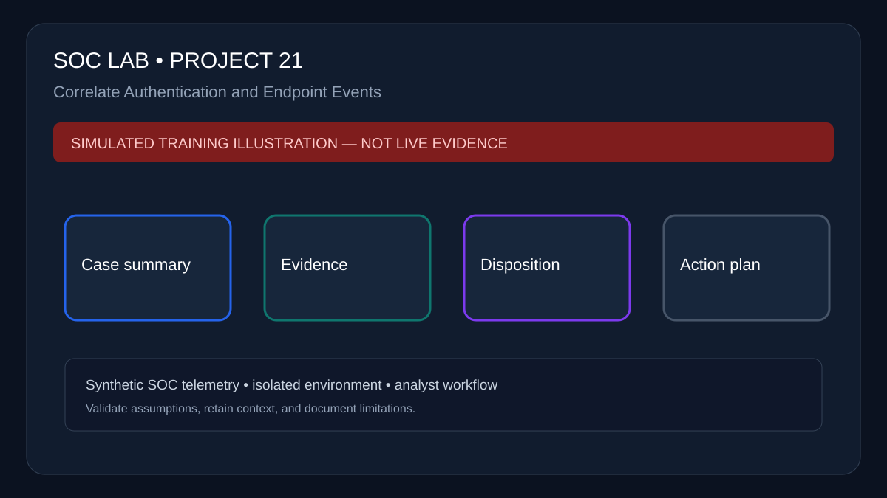

# Project 21: Correlate Authentication and Endpoint Events

**Level:** Intermediate · **Track:** SOC Operations / SIEM



## Objective
Correlate Authentication and Endpoint Events. Build a repeatable investigation or detection workflow that combines context from multiple authorized telemetry sources.

## Scope and safety
Operate only in an approved lab or monitored environment. Use synthetic/sanitized events, never real credentials or customer records. No disruptive activity or uncontrolled blocking actions.

## Prerequisites
Elastic/Splunk, Windows Event Logs and Sysmon, Linux authentication logs, DNS/firewall/network sample data, and basic query proficiency. Keep clocks synchronized and evidence access-controlled.

## Lab preparation
1. Record scope, authorization, data sources, hosts, and time zone.
2. Import baseline plus synthetic scenario records; preserve originals.
3. Verify ingestion, field normalization, event timestamps, and entity identifiers.
4. Identify expected benign patterns and data-source blind spots.

## Guided workflow
1. Define the hypothesis and the entities to correlate (user, host, source, destination, process, or domain).
2. Choose stable join keys and a bounded time window; document cardinality and missing-field behavior.
3. Build a query or analytic and add context fields needed by an analyst.
4. Validate with positive synthetic records and benign controls; check duplicates and late-arriving events.
5. Pivot to related events and reconstruct a chronological sequence.
6. Assess confidence, scope, impact, severity, and escalation needs.
7. Record evidence references, query version, limitations, and recommended defensive action.


## Example query pattern
Adapt syntax and field names to your SIEM:

```text
index=lab (sourcetype=auth OR sourcetype=endpoint) | stats values(event_type) as activity values(host) as hosts by user
```

Use a bounded time range. Validate join keys and avoid assuming that matching usernames across systems always identify the same person.

## Expected observations
Correlated event sequence, traceable source records, explainable detection rationale, benign comparison, and recorded telemetry gaps. Results should be reproducible by another analyst.

## Triage and severity
Evaluate identity privilege, asset criticality, corroborating events, source reputation, and evidence of successful access or impact. Do not escalate solely from a single weak indicator.

## Framework mapping
Map only demonstrated activity to ATT&CK and record the log sources that enable detection. Use NIST CSF/CIS Controls to prioritize defensive improvements; do not claim compliance from this project.

## Remediation
Improve identity and endpoint visibility, DNS/network logging, least privilege, asset inventory, and response playbooks. Keep automated containment approval-gated.

## Validation checklist
- [ ] Hypothesis, scope, and entities documented.
- [ ] Field normalization and join keys tested.
- [ ] Time window and query saved.
- [ ] Positive and benign controls evaluated.
- [ ] Duplicates, late events, and missing data assessed.
- [ ] Triage rationale and limitations documented.
- [ ] Retest plan and owner assigned.



## Deliverables
Query/analytic, data-source map, sanitized event samples, timeline, test results, ATT&CK mapping, triage notes, remediation recommendations, and final report. SVGs are simulated training visuals, not live screenshots or evidence.
