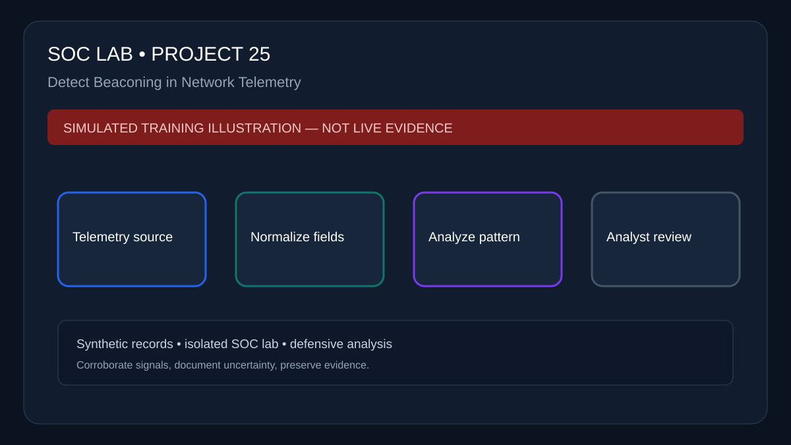
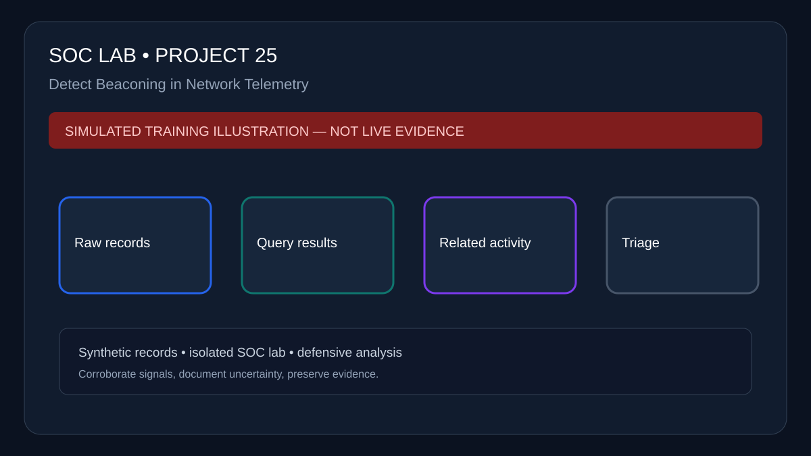
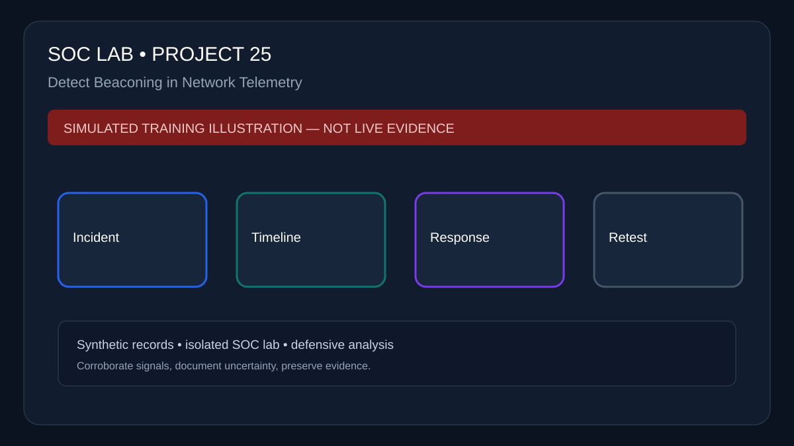

# Project 25: Detect Beaconing in Network Telemetry

**Level:** Intermediate · **Track:** SOC Operations / SIEM



## Objective
Detect Beaconing in Network Telemetry. Develop an analyst-ready workflow using authorized network, identity, endpoint, or message telemetry.

## Scope and safety
Use an isolated lab, approved monitoring scope, and synthetic/sanitized datasets. Do not intercept third-party traffic, send phishing to real users, or run disruptive tests. Protect sensitive logs and indicators.

## Prerequisites
SIEM platform (Elastic/Splunk), sample DNS/proxy/firewall/VPN/endpoint records, query skills, synchronized clocks, and an evidence notebook.

## Lab preparation
1. Document authorization, lab topology, data sources, time range, and retention.
2. Import baseline and scenario telemetry with original samples stored read-only.
3. Validate parsing, source attribution, time zones, and required fields.
4. Identify expected benign activity such as software updates, remote administration, and shared egress.

## Guided workflow
1. State the hypothesis and the entities/events needed to test it.
2. Normalize relevant fields and define aggregation keys and bounded time windows.
3. Build searches or playbook steps that provide context rather than relying on one indicator.
4. Test with synthetic positive and benign records; note expected matches and misses.
5. Pivot across DNS, proxy, firewall, VPN, identity, and endpoint data as appropriate.
6. Build a timeline, scope affected assets/users, and assess confidence and impact.
7. Document triage, escalation, containment options, and evidence preservation.



## Example SIEM query
Adapt field names to your platform:

```text
index=lab sourcetype=network:* | stats count dc(dest) as destinations by src, domain | sort - count
```

Bound the time range and account for NAT, proxies, shared infrastructure, and expected service traffic. A pattern alone is not conclusive.

## Expected observations
A reproducible analytic/playbook, source event references, a chronological timeline, benign comparisons, and documented data limitations.

## Triage and severity
Consider asset criticality, account privilege, external exposure, related endpoint events, and evidence of successful access or data movement. Escalate only with a clear rationale and preserve uncertainty where evidence is incomplete.

## Framework mapping
Map evidenced behaviors to ATT&CK and list telemetry dependencies. Use NIST CSF/CIS Controls as defensive references, not a compliance claim.

## Remediation
Apply secure network configuration, DNS/proxy visibility, MFA, least privilege, endpoint monitoring, email controls, and user reporting procedures as relevant. Keep disruptive containment approval-gated.

## Validation checklist
- [ ] Scope and data sources recorded.
- [ ] Parsing and time normalization validated.
- [ ] Positive and benign tests included.
- [ ] Query/playbook versioned and reproducible.
- [ ] False positives and blind spots documented.
- [ ] Timeline and evidence references preserved.
- [ ] Remediation and retest criteria assigned.



## Deliverables
Searches/playbook, sanitized dataset, source map, timeline, triage decision, ATT&CK mapping, tuning notes, remediation plan, and final report. All SVGs are simulated training illustrations, not actual incident evidence.
