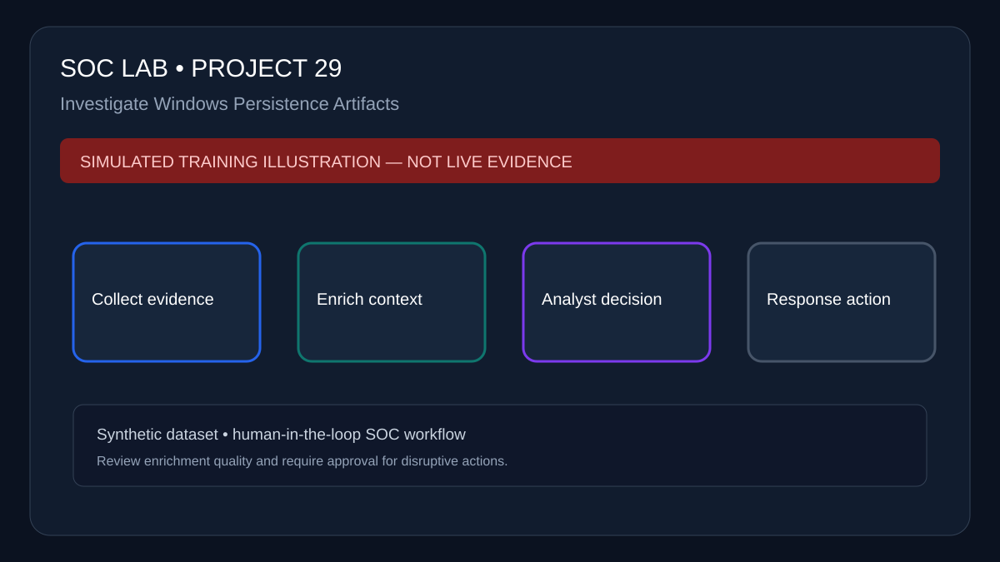
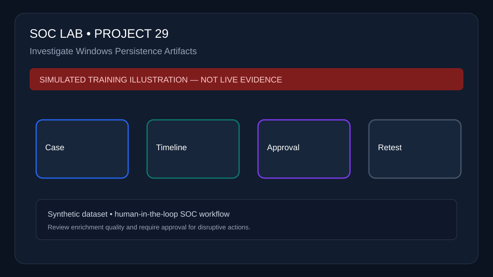

# Project 29: Investigate Windows Persistence Artifacts

**Level:** Intermediate · **Track:** SOC Operations / SIEM



## Objective
Investigate Windows Persistence Artifacts. Create an explainable and auditable analyst workflow from authorized telemetry, enrichment sources, and controlled response procedures.

## Scope and safety
Use isolated lab systems and synthetic/sanitized events. Threat-intelligence lookups must not disclose private indicators or customer data. Automation must be non-destructive by default; human approval is required before account disablement, endpoint isolation, blocking, or deletion.

## Prerequisites
Elastic/Splunk, endpoint and identity sample logs, curated synthetic indicators, Python or SOAR-style workflow tooling, and version control.

## Lab preparation
1. Define approved data sources, lab assets, retention, and access controls.
2. Import baseline and scenario records; preserve original evidence.
3. Verify timestamps, parsing, entity identifiers, and enrichment source provenance.
4. Define confidence, expiration, allow-list, and escalation rules before processing indicators.

## Guided workflow
1. State the use case, hypothesis, and expected analyst outcome.
2. Collect relevant events and normalize fields; retain source references.
3. Add context such as asset owner, identity privilege, reputation, or vulnerability metadata.
4. Validate enrichment freshness, confidence, and false-positive risk.
5. Build a rule or playbook with clear branching and safe failure handling.
6. Test normal, suspicious, missing-data, stale-indicator, and duplicate-event cases.
7. Create a case record with evidence, analyst decision, approval state, and audit trail.


## Example search pattern
Adapt to your SIEM:

```text
index=lab | stats count values(source) as sources by indicator, host, user | sort - count
```

Treat reputation and enrichment as supporting context only. Confirm indicators against original event evidence and document data freshness.

## Expected results
Versioned analytic/playbook, enrichment provenance, test matrix, alert/case examples, documented human approval gates, and safe rollback behavior.

## Triage and severity
Assess asset criticality, identity privilege, event confidence, enrichment age, corroborating telemetry, and impact. Do not make automatic high-impact decisions from a single third-party reputation score.

## Framework mapping
Map observed behavior to ATT&CK where supported. Record control objectives and audit requirements for automation, evidence handling, and change management.

## Remediation and governance
Use least privilege for service accounts, secrets management, signed/versioned workflows, logging, rate limits, error handling, and periodic feed/rule review. Define an owner and rollback procedure.

## Validation checklist
- [ ] Source provenance and scope recorded.
- [ ] Enrichment freshness and confidence evaluated.
- [ ] Positive, benign, stale, and missing-data cases tested.
- [ ] Automation permissions minimized.
- [ ] Human approval gates and rollback verified.
- [ ] Audit trail captures inputs and decisions.
- [ ] Tuning and limitations documented.



## Deliverables
Workflow/rule, test matrix, sanitized events, enrichment source register, approval model, audit examples, response playbook, and final report. SVGs are simulated training visuals, not live incident evidence.
