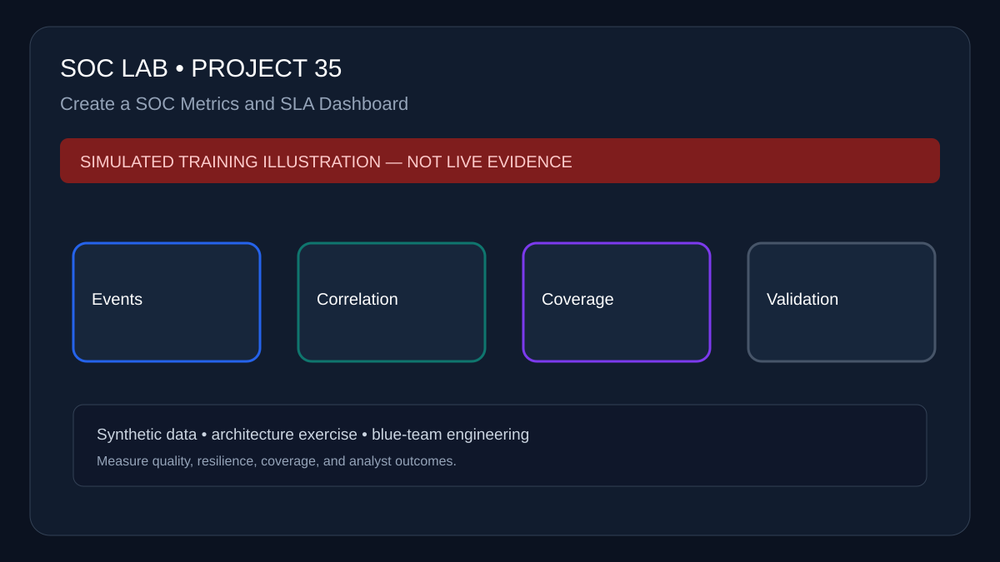
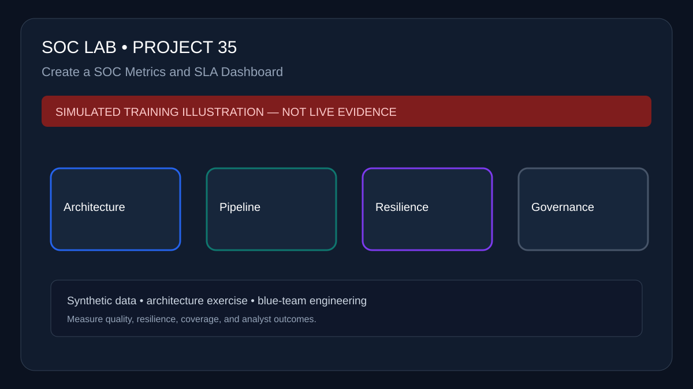

# Project 35: Create a SOC Metrics and SLA Dashboard

**Level:** Intermediate · **Track:** SOC Operations / SIEM


## Objective
Create a SOC Metrics and SLA Dashboard. Deliver an operationally sound design or analytic with documented assumptions, test evidence, and measurable outcomes.

## Scope and safety
Use authorized systems, isolated lab data, and synthetic/sanitized telemetry. Protect sensitive logs and secrets. Avoid unapproved production changes; any containment or blocking action requires an approved change and rollback plan.

## Prerequisites
SIEM platform (Elastic/Splunk or equivalent), endpoint/identity/network/cloud sample telemetry, version control, basic scripting/query skills, and documented data retention requirements.

## Lab preparation
1. Define business objectives, scope, owners, data classifications, and retention.
2. Inventory log sources, collection agents, parsing stages, storage, and analyst access.
3. Import representative baseline and scenario datasets.
4. Validate time synchronization, field quality, access controls, and failure monitoring.

## Guided workflow
1. Translate the use case into explicit requirements and success measures.
2. Document data flow and dependencies; identify collection, parsing, and coverage gaps.
3. Implement the analytic/design with versioned configuration and least-privilege access.
4. Test normal, suspicious, missing-data, high-volume, and failure scenarios.
5. Measure alert quality, ingestion latency, coverage, operational load, and recovery behavior as applicable.
6. Review results with an analyst/operator and refine thresholds or architecture.
7. Produce an implementation plan, risk register, and rollback/retest criteria.



## Example measurement query
Adapt field names to your SIEM:

```text
index=lab | stats count as events dc(host) as reporting_hosts by sourcetype
```

Document the measurement period and denominator. Do not compare metrics across environments without consistent definitions and collection scope.

## Expected results
Versioned configuration or analytic, architecture/data-flow diagram, test matrix, metric definitions, documented limitations, and prioritized improvement plan.

## Risk and severity considerations
Assess business criticality, sensitive data, identity privilege, service availability, and the impact of false positives or missed detections. Explicitly identify single points of failure and operational dependencies.

## Framework mapping
Map detections to ATT&CK where evidence supports it. Reference NIST CSF/CIS Controls for governance and control design without claiming certification or audit compliance.

## Remediation and operations
Prioritize reliable collection, secure transport, least privilege, encryption, retention, backup, monitoring of the monitoring platform, documented ownership, and change control. Establish service-level targets that can be measured.

## Validation checklist
- [ ] Requirements and scope approved.
- [ ] Data flow, ownership, and retention documented.
- [ ] Access and secrets protected.
- [ ] Positive, benign, and failure tests completed.
- [ ] Metrics have clear definitions and denominators.
- [ ] Operational risks and rollback documented.
- [ ] Retest owner and review cadence assigned.



## Deliverables
Design/rule/configuration, data-source map, test results, metrics, risk register, runbook, and final engineering report. SVGs are simulated training visuals, not live system screenshots or evidence.
